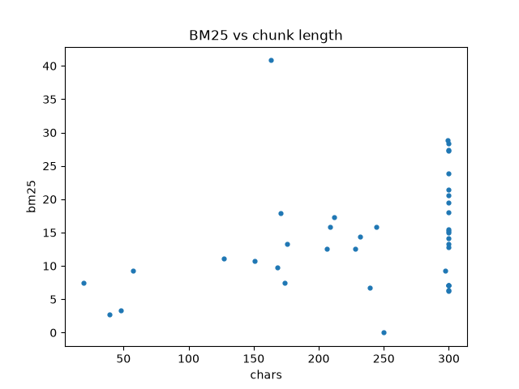
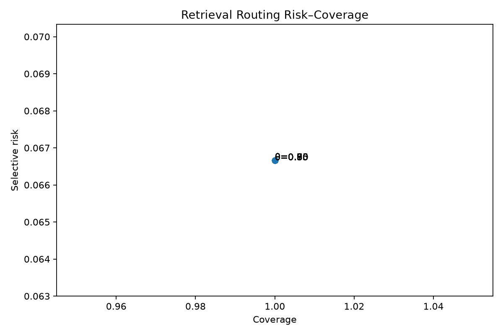
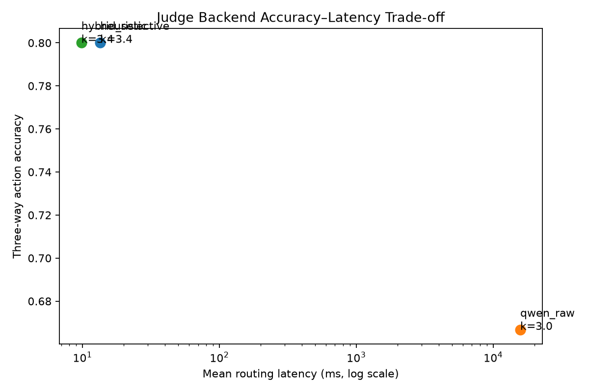

# RubbishRAG — Engineering Proof

**Candidate:** Erfan Zare (`@mr-zare`)  
**Submission branch:** `solution/mr-zare`  
**Runtime:** Python 3.11, CPU  
**Implemented scope:** Core A–D, Elective F–G, Staff Bonus

---

## 1. Objective

The initial system relied too heavily on retrieval order and lexical overlap. It was vulnerable to repeated keywords, Persian text variation, ambiguous questions, polarity errors, and untrusted retrieved content.

The final design separates five responsibilities:

1. Persian query understanding;
2. candidate retrieval and fusion;
3. semantic reranking;
4. trusted evidence construction;
5. answer / clarify / abstain decisions.

The production answer path remains deterministic. The optional Staff Judge controls retrieval effort and context budget, but it does not override provenance or evidence-sufficiency rules.

---

## 2. Final Architecture

    User query
        │
        ▼
    Persian normalization
    + semantic frame
    (intent, entities, quantities, polarity)
        │
        ▼
    Candidate retrieval
        │
        ├── RRF fusion
        ├── trusted-local rehydration
        └── local candidate recovery when needed
        │
        ▼
    Semantic reranking
        │
        ▼
    Evidence validation
    (trust, consistency, requirement coverage)
        │
        ▼
    Smallest sufficient evidence set
    (up to 3 citations)
        │
        ▼
    Answer / Clarify / Abstain

Remote retrieval is treated as candidate discovery rather than a source of truth. A retrieved item becomes citation-eligible only after provenance and content checks.

---

## 3. Core Implementation

### Core A–B — Retrieval and Ranking

Diagnostic probing showed that lexical overlap alone was not reliable. Repetition and keyword stuffing could promote incorrect documents, while a correct document could be missed if it never entered the candidate set.

The final path uses RRF for rank fusion and a structured reranker that considers lexical match, intent, entities, quantities, and polarity. Exact trusted FAQ matches can also enter candidate generation directly.

### Core C — Persian Understanding

Normalization handles Unicode consistency, Arabic/Persian character variants, Persian and Latin digits, controlled ZWNJ processing, and limited colloquial variants.

The query parser extracts:

- intent;
- bank and rank entities;
- debt types;
- numeric quantities and comparisons;
- proposition polarity.

The same structured representation is reused by reranking, evidence selection, and clarification logic.

### Core D — Chunking and Metadata

Documents are split on sentence-aware boundaries while retaining source identity and metadata. This keeps evidence readable and traceable without losing document provenance.

---

## 4. Robustness and Safety

### Elective F — Provenance and Adversarial Evidence

Remote scores and document IDs are not treated as trust signals.

Known documents are rehydrated from the trusted local corpus. Unknown remote IDs are not citation-eligible. Duplicate evidence is removed before final selection.

Regression tests cover unknown IDs, keyword stuffing, tampered known documents, duplicates, and conflicting evidence.

**Observed untrusted/poison citation rate in covered regression tests: 0%.**

### Elective G — Negation and Polarity

Polarity is evaluated at clause and target level. Debt existence and the effect of debt on a credit score are treated as separate propositions.

This prevents opposing evidence from being accepted simply because it shares the same topic words.

**Observed opposing-polarity citation rate in covered regression tests: 0%.**

---

## 5. Main Results

| Metric | Result |
|---|---:|
| Initial visible benchmark accuracy | 30% |
| Final visible benchmark accuracy | 100% (20/20) |
| Final offline regression suite | 149/149 passed |
| Stored remote trace Hit@3 | 40.0% |
| Stored remote trace Hit@5 | 55.0% |
| Stored remote trace MRR@5 | 0.3517 |
| Stored remote trace nDCG@5 | 0.4005 |
| Verified-local replay Hit@3 | 100% |
| Verified-local replay nDCG@5 | 1.000 |
| Staff Judge routing accuracy | 93.3% |
| Clarification F1 | 0.667 |
| Brier score | 0.0624 |
| Expected Calibration Error | 0.022 |
| Dynamic context-budget saving vs. fixed k=5 | 32.0% |
| Measured tokenizer-level context saving | 28.46% |

The stored remote trace numbers are diagnostic IR metrics from already-recorded retrieval traces. The verified-local numbers measure the trusted local ranking subsystem. They should not be interpreted as hidden-test estimates.

The last network-backed visible benchmark reached 20/20 before retrieval quota exhaustion. After that point, the production ranking path was frozen and later work focused on robustness, testing, and the optional Staff layer.

---

## 6. Staff Bonus — Adaptive System-1 Judge

The optional Staff layer supports:

    route query
       │
       ├── no retrieval
       ├── clarification
       └── retrieval
              │
              ▼
         dynamic top-k
              │
              ▼
       evidence sufficiency
              │
         ┌────┴────┐
         │         │
       answer   retrieve more
                   │
                   ▼
            at most one extra round
                   │
              answer / abstain

The adaptive loop is bounded to two retrieval rounds. Low-confidence decisions may broaden the retrieval budget or escalate to an optional local open-weight model.

`OpenWeightLLMJudge` is local-only and uses `local_files_only=True`. If the local model is unavailable or returns invalid structured output, the system falls back to the deterministic heuristic controller.

`Qwen2.5-0.5B-Instruct` was successfully executed on CPU. In the stricter three-way action ablation, raw Qwen achieved 66.7% accuracy but required about 15.8 seconds per decision on average. It is therefore retained only as an optional escalation backend.

### Judge quality and calibration

The official Staff test split produced:

- routing accuracy: **93.3%**;
- clarification F1: **0.667**;
- Brier score: **0.0624**;
- ECE: **0.022**;
- mean dynamic top-k: **3.4**, compared with fixed **k=5**.

The dynamic top-k policy gives a 32% context-budget reduction. Counting actual context tokens with the Qwen tokenizer reduced context from 20,699 to 14,808 tokens, a measured saving of **28.46%**.

The risk–coverage result also shows a limitation of this small test set: confidence values are concentrated. Coverage remains 100% through a threshold of 0.95 with 6.67% selective risk, then falls to zero at 0.99.

### Backend trade-off

Measured hybrid latency:

| Percentile | Latency |
|---|---:|
| p50 | 9.94 ms |
| p95 | 11.96 ms |
| p99 | 13.69 ms |

Raw Qwen remains mathematically non-dominated only because it requests a slightly smaller mean context budget; in practice, its much higher latency and lower routing accuracy make the selective heuristic path the useful operating point.

---

## 7. Trace Evidence

Representative Core-A traces remain reproducible from `traces/trace.jsonl`.

| Trace line | Scenario |
|---:|---|
| 1 | C1 query with adversarial retrieval |
| 2 | Colloquial tax-debt removal |
| 4 | Returned-check / 24-hour condition |
| 5 | Short numeric query: `۴۸۰ شدم. چرا؟` |
| 7 | Guarantor with delayed installments |
| 8 | Profitable company with missing credit score |
| 11 | Colloquial returned-check removal |
| 14 | Export/import ambiguity |
| 17 | C3 query with adversarial retrieval |
| 18 | Supplier-debt semantics |

Example:

    sed -n '14p' traces/trace.jsonl

Detailed experiment history is kept in `docs/EXPERIMENT_LOG.md`; this report intentionally keeps only evaluator-facing evidence.

---

## 8. Reproducibility

Main offline checks:

    python -m pytest -q tests/ --ignore=tests/test_cli.py
    python rubbish.py judge-bench --split test
    python scripts/final_glossary_metrics.py --tokenizer-model /path/to/Qwen2.5-0.5B-Instruct

Key evidence artifacts:

- `traces/glossary_metrics.json`
- `traces/judge_backend_ablation.json`
- `plots/length_vs_bm25.png`
- `plots/judge_risk_coverage.png`
- `plots/judge_pareto_frontier.png`
- `docs/EXPERIMENT_LOG.md`

---

## 9. Conclusion

The main improvement is the separation of retrieval from trust.

The final system normalizes and interprets Persian queries before ranking, treats remote retrieval as candidate discovery, validates evidence against the trusted corpus, rejects conflicting or untrusted evidence, and answers only when the selected evidence is sufficient.

This keeps the production path small and deterministic while the optional Staff layer provides adaptive routing, context control, and measured escalation behavior.
